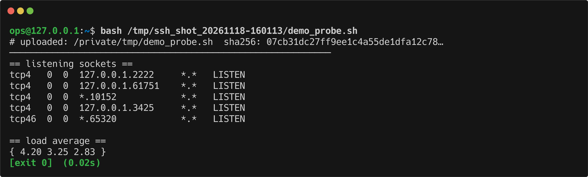

<div align="center">

# ssh-shot

**SSH 远程执行命令 / 脚本，把每条输出渲染成终端风格 PNG 截图 + 清单归档**

<sub>Run commands or scripts over SSH, render every output as a terminal-style PNG, ship a machine-readable manifest.</sub>

[](LICENSE)
[](https://www.python.org/)
[](https://www.paramiko.org/)
[](https://github.com/homeport/termshot)
[]()
[](https://github.com/rootphantomer/ssh-shot-skill/pulls)

</div>



---

## 目录

- [简介](#简介)
- [特性](#特性)
- [环境要求](#环境要求)
- [安装](#安装)
- [快速开始](#快速开始)
- [用法](#用法)
  - [执行命令](#执行命令)
  - [命令清单](#命令清单)
  - [本地脚本](#本地脚本)
  - [远端脚本](#远端脚本)
  - [完整参数](#完整参数)
- [输出结构](#输出结构)
- [工作原理](#工作原理)
- [作为 Agent Skill 使用](#作为-agent-skill-使用)
- [安全说明](#安全说明)
- [已知限制](#已知限制)
- [开发与测试](#开发与测试)
- [贡献](#贡献)
- [许可证](#许可证)

---

## 简介

`ssh-shot` 把「连上去跑命令」和「截图留证」合成一步。给出目标主机与凭据，它会：

1. 通过 SSH 登录（密码 / 私钥 / ssh-agent）；
2. 逐条执行命令或脚本（申请 PTY，保留远端 ANSI 颜色）；
3. 把每条输出交给 [termshot](https://github.com/homeport/termshot) 渲染成一张终端风格 PNG；
4. 生成 `manifest.json`，记录命令原文、退出码、耗时、输出字节数与脚本 SHA-256。

适合需要「可复核证据」而不是一段随手复制文本的场景：服务器巡检、安全基线核查、故障排查、应急响应验证、审计取证。

## 特性

- **四种执行源，可任意混用**：`-c` 命令、`--commands-json` 清单、`--script` 本地脚本、`--remote-script` 远端脚本。
- **真实终端观感**：PTY + `xterm-256color`，`ls --color`、`systemctl status` 等彩色输出完整保留。
- **溯源信息内嵌在图上**：每张图自带 `[row03] 名称 (3/5)`、命令原文、`[exit N] (耗时)`；脚本任务额外带本地路径与 SHA-256。
- **脚本上传即用即清**：本地脚本经 SFTP 上传、`chmod 700`、执行完毕后默认删除，远端不留残留。
- **远端脚本可存证**：`--remote-script` 会把脚本内容拉回证据目录并计入 SHA-256，证明「跑的是哪一份」。
- **原始文本另存**：每张图都附带同名的 `.ansi` 原文，可随时重新渲染，不必再连一次。
- **失败可见**：超时标黄、非零退出标红，既画在图上也写进清单；单条命令失败不会中断整批采集。

## 环境要求

| 组件 | 版本 | 说明 |
| --- | --- | --- |
| Python | 3.9+ | 仅用于本机脚本（远端无需 Python） |
| [paramiko](https://www.paramiko.org/) | 3.0+ | SSH / SFTP 客户端 |
| [termshot](https://github.com/homeport/termshot) | 0.4+ | ANSI → PNG 渲染器（Go CLI） |
| 操作系统 | macOS / Linux | Windows 请使用 WSL 或 Git Bash |

## 安装

### 一键安装

```bash
git clone https://github.com/rootphantomer/ssh-shot-skill.git && cd ssh-shot-skill
bash scripts/install.sh
```

`install.sh` 会创建 `.venv` 并安装 paramiko，然后安装 termshot：优先 `go install`，没有 Go 则提示使用 Homebrew 或下载 Release。

### 手动安装

```bash
# 1) Python 依赖（任选其一）
uv venv .venv && uv pip install --python .venv/bin/python 'paramiko>=3.0'
python3 -m venv .venv && ./.venv/bin/python -m pip install 'paramiko>=3.0'

# 2) termshot（任选其一）
go install github.com/homeport/termshot/cmd/termshot@latest   # 产物位于 $(go env GOPATH)/bin/termshot
brew install homeport/tap/termshot
```

脚本会在 `PATH`、`~/go/bin`、`/usr/local/bin`、`/opt/homebrew/bin`、`/usr/bin` 中查找 termshot；也可以用 `--termshot /path/to/termshot` 显式指定。

## 快速开始

```bash
./.venv/bin/python scripts/ssh_shot.py \
    --host 10.0.0.5 -u root -p 'YOUR_PASSWORD' \
    -c "uname -a; uptime" -c "ss -lntp"
```

执行结束会打印证据目录，其中包含每一条命令的 `.ansi`、`.png` 与总清单 `manifest.json`。

> 省略 `-p` 时脚本会用 `getpass` 交互索要密码，避免明文留在 shell history 里。

## 用法

### 执行命令

```bash
# 单条
$PY scripts/ssh_shot.py --host 10.0.0.5 -p 'PASS' -c "uname -a"

# 多条（按顺序，各出一张图）
$PY scripts/ssh_shot.py --host 10.0.0.5 -p 'PASS' \
    -c "hostname; uptime" \
    -c "df -h" \
    -c "ss -lntp"

# 私钥 + 非默认端口 + 窄终端
$PY scripts/ssh_shot.py --host 10.0.0.5 --port 2222 -u ops -i ~/.ssh/id_ed25519 \
    -c "systemctl status sshd" --cols 160
```

### 命令清单

批量巡检推荐使用 JSON 清单，格式见 [`scripts/commands.sample.json`](scripts/commands.sample.json)：

```json
[
  {
    "id": "row01",
    "name": "basic-info",
    "command": "hostname; uname -a; id",
    "timeout": 30
  }
]
```

| 字段 | 必填 | 说明 |
| --- | --- | --- |
| `id` | 否 | 截图文件名前缀，缺省自动编号 `rowNN`；会做文件名安全化处理 |
| `name` | 否 | 描述性标签，只用于清单与截图标题 |
| `command` | 是 | 实际下发的命令 |
| `timeout` | 否 | 本条命令的超时秒数，覆盖全局 `--timeout` |

```bash
$PY scripts/ssh_shot.py --host 10.0.0.5 -p 'PASS' \
    --commands-json scripts/commands.sample.json -o ./evidence
```

### 本地脚本

```bash
$PY scripts/ssh_shot.py --host 10.0.0.5 -p 'PASS' --script ./baseline.sh
```

流程：SFTP 上传到 `--remote-dir`（默认 `/tmp/ssh_shot_<时间戳>/`）→ `chmod 700` → 执行 → 截图 → 默认删除远端文件与目录。

脚本原件会同时复制进证据目录（`script.row01.baseline.sh`），SHA-256 写入清单，并显示在截图溯源行上。

```bash
# 保留远端脚本便于复查；指定解释器；换上传目录
$PY scripts/ssh_shot.py --host 10.0.0.5 -p 'PASS' --script ./baseline.sh \
    --keep-remote --remote-dir /tmp/audit --shell "bash -e"
```

### 远端脚本

目标机上已有脚本时，直接指向它即可，**不会修改远端任何文件**：

```bash
$PY scripts/ssh_shot.py --host 10.0.0.5 -p 'PASS' --remote-script /opt/audit/os.sh
```

执行前会先 `stat` 确认存在（不存在则直接报错，不会留下一条 `exit 127` 的假证据），随后按首行 shebang 推断解释器，并把脚本内容拉回证据目录存证（`--no-fetch-script` 可关闭）。

**解释器推断顺序**：`--shell` 显式指定 → 扩展名（`.sh`→`bash`、`.py`→`python3`、`.pl`→`perl`…）→ shebang（支持 `#!/usr/bin/env python3`、`#!/bin/bash -e` 等）→ 兜底 `bash`。

### 完整参数

<details open>
<summary><b>连接</b></summary>

| 参数 | 默认值 | 说明 |
| --- | --- | --- |
| `--host` | 必填 | 目标主机 IP / 域名 |
| `--port` | `22` | SSH 端口 |
| `-u, --user` | `root` | 登录用户名 |
| `-p, --password` | 交互输入 | 密码 |
| `-i, --key` | – | 私钥路径 |
| `--key-passphrase` | – | 私钥口令（或用 `--ask-key-passphrase` 交互输入） |
| `--no-agent` | 关 | 不使用 ssh-agent |
| `--connect-timeout` | `15` | 连接超时（秒） |

</details>

<details open>
<summary><b>执行源</b></summary>

| 参数 | 说明 |
| --- | --- |
| `-c, --command` | 要执行的命令，可重复 |
| `--commands-json` | 命令清单 JSON 文件 |
| `--script` | 本地脚本：上传后执行，可重复 |
| `--remote-script` | 远端已有脚本路径，可重复 |
| `--shell` | 解释器，如 `bash`、`python3`、`"bash -e"` |
| `--remote-dir` | 上传目录，默认 `/tmp/ssh_shot_<时间戳>` |
| `--keep-remote` | 保留远端上传的脚本与目录 |
| `--no-fetch-script` | 不把远端脚本拉回证据目录 |
| `--timeout` | 单条命令超时（秒），默认 `60` |

</details>

<details>
<summary><b>终端与会话</b></summary>

| 参数 | 默认值 | 说明 |
| --- | --- | --- |
| `--cols` | `200` | 远端 PTY 列宽 |
| `--rows` | `60` | 远端 PTY 行高 |
| `--term` | `xterm-256color` | PTY `TERM` 类型 |
| `--no-pty` | 关 | 不申请 PTY：无颜色，但不会被分页器卡住 |
| `--keep-cr` | 关 | 保留 `\r`（默认转换为 `\n`） |

</details>

<details>
<summary><b>输出与渲染</b></summary>

| 参数 | 默认值 | 说明 |
| --- | --- | --- |
| `-o, --output` | `./evidence` | 证据根目录 |
| `--termshot` | 自动查找 | termshot 可执行文件路径 |
| `--no-render` | 关 | 只保存 `.ansi`，不出图 |
| `--render-columns` | `0` | 出图时强制换行列数（`0` 为不强制） |
| `--margin` / `--padding` | – | 图片外边距 / 内边距（像素） |
| `--no-shadow` / `--no-decoration` | 关 | 去掉窗口阴影 / 标题栏按钮 |
| `--render-timeout` | `90` | 单张渲染超时（秒） |

</details>

## 输出结构

```text
evidence/
└── 10.0.0.5_20261118-110852/
    ├── manifest.json              # 主机、时间、渲染参数、脚本信息、每条命令的结果
    ├── row01.ansi                 # 捕获到的原始 ANSI 文本（可重新渲染）
    ├── row01.png                  # 截图
    ├── row02.ansi
    ├── row02.png
    └── script.row02.baseline.sh   # 脚本存证副本（SHA-256 记在清单里）
```

`manifest.json` 结构：

```json
{
  "tool": "ssh_shot.py",
  "created_at": "2026-11-18T11:08:52",
  "target": { "host": "10.0.0.5", "port": 22, "user": "root" },
  "render": { "termshot": "/usr/local/bin/termshot", "pty": true, "cols": 200, "rows": 60 },
  "scripts": { "remote_dir": "/tmp/ssh_shot_20261118-110852", "kept": false, "uploaded": ["/tmp/ssh_shot_20261118-110852/baseline.sh"] },
  "summary": { "total": 2, "ok": 2, "failed": 0 },
  "results": [
    {
      "id": "row01",
      "command": "uname -a",
      "exit_status": 0,
      "duration": 0.04,
      "output_bytes": 531,
      "ansi_file": "row01.ansi",
      "png_file": "row01.png",
      "sha256": "",
      "error": "",
      "timed_out": false
    }
  ]
}
```

重新渲染任意一页（无需再次连接目标机）：

```bash
termshot --raw-read evidence/10.0.0.5_20261118-110852/row01.ansi \
         --filename row01.png
```

**退出码**

| 码 | 含义 |
| --- | --- |
| `0` | 全部采集成功 |
| `1` | 有命令失败或超时（截图仍会生成，图上以红/黄字标注） |
| `2` | 参数或环境问题，例如 termshot 缺失、脚本不存在 |

## 工作原理

```text
                ┌────────────┐   ① exec + PTY (xterm-256color)   ┌────────────┐
  本地 ─────────│  paramiko  │──────────────────────────────────▶│  目标主机   │
                │  SSHClient │◀──────────────────────────────────│  shell     │
                └─────┬──────┘   ② stdout/stderr 原始 ANSI       └────────────┘
                      │
                      │ ③ 加上溯源头（命令原文 / sha256 / exit / 耗时）
                      ▼
                row01.ansi ──④ termshot --raw-read──▶ row01.png
                      │
                      └──⑤ 汇总 ──▶ manifest.json
```

不依赖本地伪终端，也不在远端启动任何常驻进程：命令输出经 SSH 通道原样取回，落盘为 ANSI 文本，再由 termshot 离屏渲染。因此渲染阶段可离线重做，也不会因为本地终端尺寸影响远端输出。

## 作为 Agent Skill 使用

本仓库同时是一个符合 [Agent Skills 规范](https://agentskills.io/specification) 的技能包：

```text
ssh-shot/
├── SKILL.md                 # 技能定义：名称、触发条件、工作流、规则、自检清单
├── references/              # 渐进式披露的细节，只在需要时加载
│   ├── cli.md               # 完整参数、退出码、manifest 字段
│   ├── troubleshooting.md   # 常见故障与处理
│   └── playbooks.md         # 只读巡检命令组（基础/账号/网络/服务/日志/补丁）
├── scripts/                 # 主程序、安装脚本、自测服务端、技能自校验
└── README.md
```

`SKILL.md` 的 `name` 字段为 `ssh-shot`，按规范**目录名需与之一致**，因此克隆时指定目录名：

```bash
git clone https://github.com/rootphantomer/ssh-shot-skill.git ssh-shot
ln -s "$PWD/ssh-shot" ~/.pi/agent/skills/ssh-shot      # pi
ln -s "$PWD/ssh-shot" ~/.claude/skills/ssh-shot        # Claude Code
```

校验技能是否符合规范：

```bash
python3 scripts/validate_skill.py .
# [ok] ssh-shot: SKILL.md 符合 Agent Skills 规范
```

随后即可用自然语言触发（Agent 会自行组装命令）：

> 「登录 10.0.0.5，跑一遍账号与端口基线检查，把结果截图归档到 evidence/」

## 安全说明

- **默认只读**：目标是采集证据，不是改配置。请对任何写操作（重启服务、改权限、清日志）预先取得授权。
- **凭据不落盘**：密码只存在于进程内存；不写日志、不写清单，建议用 `--key` 或交互输入而非 `-p`（避免 shell history）。
- **远端零残留**：上传的脚本执行完毕即删除（`--keep-remote` 可保留），不安装任何软件、不写系统目录。
- **敏感输出**：如命令结果含口令、密钥、令牌，请事先裁剪命令，或对 `.ansi` 使用 `termshot --edit` 后再出图。
- **主机密钥**：默认接受未知主机密钥（`AutoAddPolicy`），便于首次连接内网设备；对高安全要求环境，请预先维护 `known_hosts` 并自行收紧策略。

## 已知限制

- 交互式程序（`less`、`vim`、`top` 全屏模式）在截图中会失真，请改用 `--no-pty` 或 `top -b -n1`、`| cat` 等非交互写法。
- 超宽单行依赖 termshot 的排版；需要严格分栏时用 `--render-columns` 显式指定列数。
- 远端登录 banner、`TMOUT` 提示会出现在输出顶部（属真实情况，不做过滤）。
- `manifest.json` 中的 SHA-256 只覆盖脚本内容，不覆盖输出内容；如需完整性证明，请对证据目录整体做签名。

## 开发与测试

仓库内置一个最小 SSH 服务端（密码认证 + exec + SFTP 子系统，仅监听 `127.0.0.1`），
无需真实目标机即可端到端验证采集链路：

```bash
./.venv/bin/python scripts/fake_sshd.py --port 2222 --password 123456 &

./.venv/bin/python scripts/ssh_shot.py --host 127.0.0.1 --port 2222 -p 123456 \
    -c "uname -a; id" \
    --script ./baseline.sh \
    --remote-script /opt/audit/os.sh \
    -o /tmp/evidence
```

`fake_sshd.py` 会把 SFTP 落到本机文件系统，**仅供本地测试**，请勿在共享网络中运行。

## 贡献

欢迎 Issue 与 Pull Request：

1. Fork 本仓库并从 `main` 拉出特性分支；
2. 保持提交信息清晰（推荐 Conventional Commits）；
3. 涉及行为的改动请补充自测步骤或更新 `SKILL.md` / `README.md`；
4. 提交前跑一遍自检：

   ```bash
   python3 -m py_compile scripts/ssh_shot.py scripts/validate_skill.py
   python3 scripts/validate_skill.py .
   ```

## 许可证

[MIT](LICENSE) © 2026 rootphantomer

## 致谢

- [termshot](https://github.com/homeport/termshot) —— 把 ANSI 渲染成终端风格图片的核心
- [paramiko](https://www.paramiko.org/) —— 纯 Python 的 SSH / SFTP 实现
